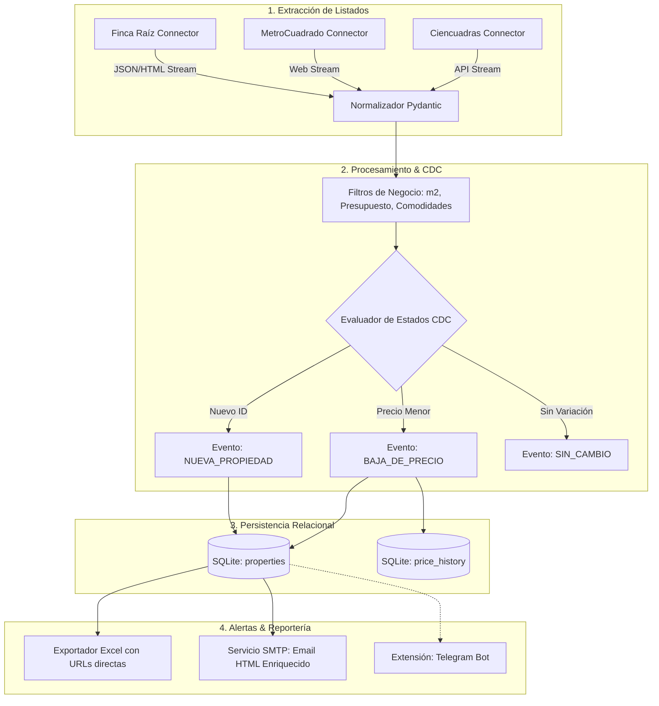

# 🏠 Real Estate Investment Monitor & CDC Engine

[](#)
[](#)
[](#)
[](#)
[](LICENSE)

Herramienta automatizada de extracción, normalización e identificación de oportunidades de inversión inmobiliaria en Colombia. Implementa un patrón de **Change Data Capture (CDC)** sobre listados inmobiliarios para detectar nuevas publicaciones, rastrear rebajas de precio históricas y alertar diariamente mediante reportes consolidados en HTML y planillas Excel.

---

## 🎯 Arquitectura del Pipeline



---

## 🚀 Características Principales

* **Normalización de Datos Inmobiliarios:** Cálculo automático de métricas de rendimiento como valor por metro cuadrado ($\text{COP}/\text{m}^2$), ambientes, superficie y filtrado de comodidades (balcón, ascensor, estado).
* **CDC Inmobiliario & Detección de Bajas:** Rastrea el historial de cambios en cada propiedad. Si un inmueble reduce su precio, calcula el porcentaje de descuento respecto a su valor anterior y preserva la auditoría en `price_history`.
* **Deduplicación Estricta:** Identificación única por combinación de portal y clave de publicación, evitando falsos positivos e inundación de reportes.
* **Módulo de Notificaciones Desacoplado:** Arquitectura extensible mediante la interfaz `BaseNotifier`. Soporta actualmente envíos por correo electrónico (HTML responsivo vía SMTP) y está preparado para conectarse a bots de mensajería (Telegram).
* **Exportación Automatizada:** Generación de planillas estructuradas en `.xlsx` con hipervínculos directos a las publicaciones originales.

---

## 🛠️ Instalación y Uso Local

### 1. Clonar y configurar entorno

```bash
git clone https://github.com/<tu-usuario>/real-estate-monitor.git
cd real-estate-monitor

python3 -m venv .venv
source .venv/bin/activate
pip install -r requirements.txt
```

### 2. Configurar Criterios de Inversión (`.env`)

Copia la plantilla de configuración:

```bash
cp .env.example .env
```

Ajusta tus parámetros en `.env`:

```ini
SEARCH_CITY=Bogota
MAX_PRICE_COP=400000000
MAX_PRICE_PER_M2_COP=7000000
MIN_AREA_M2=45
MIN_ROOMS=2
REQUIRE_ELEVATOR=false
REQUIRE_BALCONY=false

# Opcional: Credenciales SMTP para envíos automáticos de correo
SMTP_HOST=smtp.gmail.com
SMTP_PORT=587
SMTP_USER=tu_correo@gmail.com
SMTP_PASSWORD=tu_app_password
EMAIL_FROM=tu_correo@gmail.com
EMAIL_TO=destinatario@correo.com
```

### 3. Ejecutar el Monitor

```bash
python -m src.main
```

Los resultados se almacenarán en `data/real_estate.db`, exportando la planilla en `data/oportunidades_YYYYMMDD_HHMMSS.xlsx` y el reporte visual en `data/last_report.html` (o enviándolo directamente si se configuraron credenciales SMTP).

---

## 👤 Autor

**Juan Camilo Marín García**  
*SQL Data Engineer & Backend Architecture Specialist*